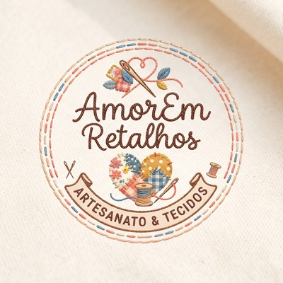

# AmorEmRetalhos — Ateliê Artesanal & Catálogo Digital

<p align="center">
  
</p>

<p align="center">
  <strong>Peças exclusivas em patchwork tradicional confeccionadas à mão com afeto, memória e durabilidade.</strong>
</p>

<p align="center">
  <a href="https://amoremretalhos.github.io"></a>
  
  
  
  
</p>

---

## 🌸 Sobre a AmorEmRetalhos

A **AmorEmRetalhos** é um ateliê artesanal brasileiro especializado na arte do patchwork clássico e contemporâneo. Cada colcha, manta e acessório têxtil é fruto de um processo manual minucioso que valoriza a memória afetiva familiar, o aconchego doméstico e a sustentabilidade no reaproveitamento nobre de tecidos.

Nossas peças combinam padronagens selecionadas a dedo — florais vintage, xadrez campestre, poás poéticos, listras e cores lisas — costuradas bloco a bloco para criar composições harmônicas que acolhem e aquecem o lar por gerações.

---

## 🛏️ Catálogo de Peças & Especificações Técnicas

| Linha | Medida da Peça | Tamanho dos Blocos | Composição dos Tecidos | Acabamento & Itens |
| :--- | :--- | :--- | :--- | :--- |
| **Colcha King Size** | 2,60 m x 2,80 m | 15x15 cm (ou 10x10 / 20x20 cm) | 100% Algodão Tricoline Nobre | Quilt livre estruturado + 2 Porta-travesseiros (50x70 cm) |
| **Colcha Queen Size** | 2,40 m x 2,60 m | 15x15 cm (ou 10x10 cm) | Algodão Puro + Florais Selecionados | Barra em viés largo trabalhado + 2 Porta-travesseiros |
| **Colcha Casal Padrão** | 2,20 m x 2,40 m | 10x10 cm ou 20x20 cm | Algodão de alta gramatura e xadrez | Costura dupla reforçada + 2 Capas de almofada (45x45 cm) |
| **Kit Almofadas & Peseiras** | 45x45 cm / 0,60 m x 2,60 m | 10x10 cm | Mix coordenado de retalhos | Zíper invisível e enchimento antialérgico siliconado |

### Padrões Construtivos de Qualidade:
- **Tecidos Pré-lavados**: Todo o tecido passa por processo de pré-lavagem que garante estabilidade dimensional (não encolhe e não desbota após a lavagem doméstica).
- **Manta Térmica Resinada**: Recheio interno macio, antialérgico e lavável que assegura conforto térmico sem pesar sobre o corpo.
- **Costuras Pespontadas Duplas**: Junções internas travadas com pespontos duplos para resistir a décadas de uso contínuo.

---

## 📐 Sistema Modular de Blocos (Mosaico)

O cliente pode personalizar a densidade visual da sua colcha escolhendo entre três modulações geométricas fundamentais:

```text
┌──────────────┐   ┌────────────────────┐   ┌──────────────────────────┐
│   10x10 cm   │   │      15x15 cm      │   │         20x20 cm         │
│ Bloco Detalhe│   │   Bloco Clássico   │   │      Bloco Amplo         │
│ (Alta escala │   │  (Padrão de ouro   │   │  (Destaque para estampas │
│  de retalhos)│   │  de equilíbrio)    │   │   grandes e modernas)    │
└──────────────┘   └────────────────────┘   └──────────────────────────┘
```

---

## 💻 Arquitetura da Plataforma Web

A presença digital da **AmorEmRetalhos** foi projetada seguindo os princípios de *Zero-Dependency Web Architecture*, priorizando velocidade extrema, leveza e acessibilidade universal:

- **HTML5 Semântico Estruturado**: Hierarquia precisa de títulos, marcos de navegação (`<header>`, `<nav>`, `<main>`, `<article>`, `<section>`, `<footer>`) e metadados Open Graph para compartilhamento rico em redes sociais.
- **CSS3 Puro Modular**:
  - Paleta baseada em variáveis CSS (*Custom Properties*) inspirada na botânica e em tecidos artesanais: terracota (`#BA4E35`), mostarda suave (`#C8821E`), verde-sálvia (`#5A7754`) e cacau profundo (`#362419`).
  - Efeitos de pesponto e acabamentos pontilhados remetendo a costura manual.
  - Tipografia de alta legibilidade combinando as famílias tipográficas *Playfair Display*, *Caveat* e *Plus Jakarta Sans*.
  - Conformidade com diretrizes **WCAG AAA** de contraste de cores.
- **Responsividade Total**: Layout fluído otimizado para celulares de qualquer resolução, tablets e monitores widescreen.
- **Performance Nativa**: Carregamento instantâneo sem frameworks ou scripts bloqueantes, alcançando pontuação máxima no Google PageSpeed Insights.

---

## 💌 Canais Oficiais de Atendimento & Encomendas

As peças são confeccionadas sob medida de acordo com a paleta de cores e o tamanho escolhido pelo cliente:

- **WhatsApp Comercial**: [+55 (67) 99299-9623](https://wa.me/5567992999623) *(Atendimento consultivo com envio de fotos de prévia dos tecidos)*
- **E-mail Institucional**: [amoremretalhos@gmail.com](mailto:amoremretalhos@gmail.com)
- **Horário de Atendimento**: Segunda a Sábado, das 08h às 18h (Horário de Brasília)
- **Ateliê & Centro de Distribuição**: Campo Grande - Mato Grosso do Sul, Brasil
- **Cobertura Logística**: Entregas em todo o território nacional via Correios (PAC / Sedex) e transportadoras parceiras com seguro e código de rastreamento.

---

## 📄 Propriedade Intelectual & Créditos

© 2024–2026 **AmorEmRetalhos**. Todos os direitos reservados.  
*Artesanato afetivo costurado com rigor, afeto e propósito.*
